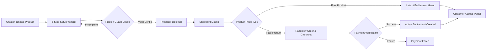
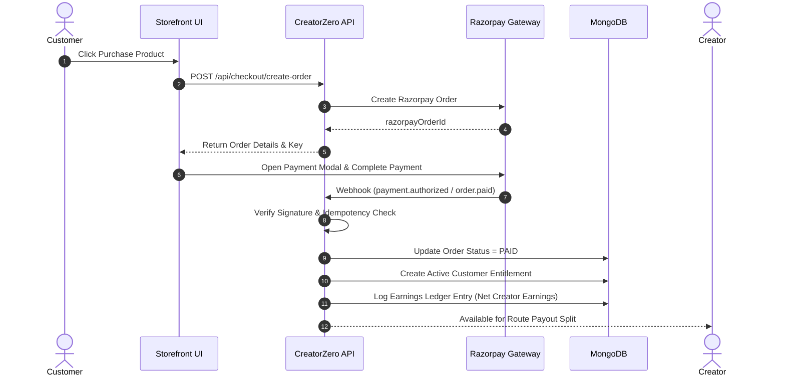
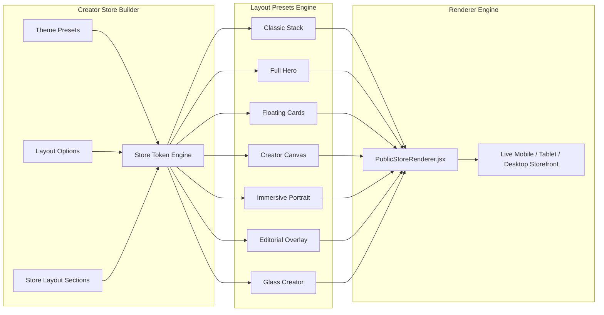

# 🚀 CreatorZero — Digital Creator Platform & Operating System

CreatorZero is a modern, full-stack, enterprise-grade web application built for digital creators to launch, brand, market, and monetize digital products, interactive courses, 1:1 coaching calls, private communities, live webinars, recurring memberships, custom services, and external resources.

---

## 📊 System Architecture & Data Flow

The diagram below illustrates the end-to-end multi-layer architecture of CreatorZero, connecting public customer storefronts, creator dashboards, REST API routes, the business logic service layer, payment providers, and MongoDB storage engines.

```mermaid
graph TD
    subgraph Client Layer
        A[Public Storefront Customer] -->|Browse / Purchase| C[Next.js Storefront App]
        B[Digital Creator] -->|Manage Store & Products| D[Next.js Creator Dashboard]
    end

    subgraph Application & API Layer
        C -->|REST API Requests| E[Centralized Route Handler /api/[[...path]]]
        D -->|REST API Requests| E
        E -->|Session Auth & Middleware| F[Service Layer /lib/services.js]
    end

    subgraph Data & Storage Layer
        F -->|DAO Operations| G[Repository Layer /lib/repos.js]
        G -->|Queries & Indexes| H[(MongoDB Database)]
        F -->|GridFS Binary Streams| I[(MongoDB GridFS Bucket)]
    end

    subgraph Payment Infrastructure
        C -->|Checkout & Orders| J[Payment Provider Layer /lib/payments.js]
        J -->|Order Creation & Verification| K[Razorpay Gateway]
        K -->|Signed Webhook Events| E
    end
```

---

## 🔄 Product Lifecycle & Customer Purchase Flow

The flowchart below shows how products move from initial creator creation through validation, store publishing, payment processing, entitlement verification, and customer access fulfillment.



---

## 💳 Payment & Earnings Payout Pipeline



---

## 🎨 Store Design System Architecture



---

## 🌟 Comprehensive Product Suite & Features

CreatorZero features **8 distinct product types**, each built with dedicated configuration wizards, security guards, customer access portals, and analytics tracking:

### 1. 📁 Digital Downloads
- **Purpose**: Sell eBooks, PDFs, design templates, code repositories, and ZIP archives.
- **Security**: Token-gated download links with single-use or time-bound download tokens.
- **Storage**: Binary streaming via MongoDB GridFS.

### 2. 🎓 Courses & Video Modules
- **Purpose**: Multi-module structured learning programs.
- **Features**: Video lesson streaming, rich text content, downloadable PDF lesson attachments, student completion progress bars, and a student learning dashboard (`/account/courses`).

### 3. 🤝 1:1 Coaching Calls
- **Purpose**: Bookable 1:1 consultation calls and guidance sessions.
- **Features**: Custom session durations (e.g. 30/60 min), working hours schedule configuration, timezone support, automatic video call meeting links, and creator booking management (`/dashboard/coaching`).

### 4. 💬 Private Communities
- **Purpose**: Exclusive group membership spaces ("Builders Club").
- **Features**: Interactive community feed, creator-pinned announcements, comments, post reactions (likes), member directory with search, and creator moderation (member suspension).

### 5. 🎥 Live Webinars
- **Purpose**: Scheduled live online events and workshops.
- **Features**: Date/time scheduling, duration & timezone controls, attendee capacity limits (automatic sold-out status), custom registration questions, meeting access links, attendee rosters, and event cancellation management.

### 6. 🔄 Memberships
- **Purpose**: Recurring subscription-based access programs.
- **Features**: Monthly/yearly billing cadence, subscription status tracking (`ACTIVE`, `CANCELLED`, `EXPIRED`), membership benefit badges, renewal billing, and subscriber account management (`/account/memberships`).

### 7. 🛠️ Custom Services
- **Purpose**: Bespoke request deliverables (Resume Reviews, Portfolio Audits, Custom Designs).
- **Features**: Custom requirement brief collection forms, creator review workflow (Accept / Decline / Clarification), file delivery uploads, and delivery status tracking (`SUBMITTED`, `IN_REVIEW`, `DELIVERED`).

### 8. 🔗 External Links
- **Purpose**: Direct access products linking to external destinations (YouTube, Discord, Notion, Calendly, Google Drive).
- **Security**: Strict URL protocol validation (blocks `javascript:`, `data:`, `file:`), zero premature URL leakage on public landing pages, server-authorized access checking, and link open analytics.

---

## 🗄️ Database Schemas & Models

CreatorZero utilizes MongoDB with optimized single and compound indexes across core collections:

| Collection Name | Key Fields | Indexes | Description |
|---|---|---|---|
| `users` | `_id`, `email`, `passwordHash`, `role` | `email` (unique) | Creator accounts and credentials |
| `profiles` | `creatorId`, `name`, `bio`, `avatarUrl`, `socialLinks` | `creatorId` (unique) | Creator brand profile & social handles |
| `stores` | `creatorId`, `username`, `theme`, `sections` | `creatorId`, `username` (unique, sparse) | Creator storefront layout & design tokens |
| `products` | `_id`, `creatorId`, `type`, `title`, `price`, `status` | `creatorId`, `(creatorId, slug)` | Master product catalog |
| `orders` | `_id`, `creatorId`, `productId`, `amount`, `status` | `creatorId`, `razorpayOrderId` | Customer transaction orders |
| `entitlements` | `_id`, `customerId`, `productId`, `status` | `orderId` (unique), `(customerId, productId)` | Customer access verification records |
| `coaching_configs` | `productId`, `creatorId`, `durationMinutes`, `schedule` | `productId` (unique) | 1:1 call schedule configurations |
| `community_configs` | `productId`, `creatorId`, `communityName`, `slug` | `productId` (unique) | Private community configuration |
| `community_posts` | `productId`, `authorId`, `content`, `isPinned` | `productId`, `createdAt` | Feed posts & announcements |
| `webinar_configs` | `productId`, `scheduledAt`, `capacity`, `meetingUrl` | `productId` (unique) | Live webinar event settings |
| `membership_configs` | `productId`, `billingCycle`, `benefits` | `productId` (unique) | Recurring subscription settings |
| `custom_service_configs` | `productId`, `deliveryDays`, `requirements` | `productId` (unique) | Service requirements brief setup |
| `external_link_configs` | `productId`, `destinationUrl`, `destinationType` | `productId` (unique) | External link security setup |
| `external_link_opens` | `productId`, `customerEmail`, `openedAt` | `(productId, customerEmail)` | External link click analytics |
| `earnings_ledger` | `creatorId`, `orderId`, `netEarnings`, `fees` | `creatorId` | Creator revenue ledger entries |

---

## 🛠️ Technology Stack & Dependencies

- **Core Engine**: Next.js 15 (App Router), React 18
- **Database Layer**: MongoDB Native Driver `v6.6` & MongoDB GridFS Bucket
- **Payment Gateway**: Razorpay Node SDK `v2.9`
- **UI Components & Styling**: Tailwind CSS `v3.4`, Radix UI Primitives, Lucide Icons `v0.516`, Framer Motion `v11.18`
- **Form & Data Validation**: React Hook Form, Zod `v3.25`
- **Toast Notifications & Feedback**: Sonner

---

## 🚀 Getting Started

### 1. Prerequisites
- **Node.js**: `v18.0.0` or higher
- **MongoDB**: MongoDB Atlas connection URI or local MongoDB instance

### 2. Environment Configuration
Create or edit `.env` in the root directory:
```env
# Server & Database
MONGO_URL=mongodb+srv://<username>:<password>@cluster0.ytxb7qt.mongodb.net/?appName=Cluster0
DB_NAME=creatorzero
NEXT_PUBLIC_BASE_URL=http://localhost:3000
NODE_ENV=development

# Security
JWT_SECRET=creatorzero_super_secret_jwt_key_2026

# Payment Gateway (Razorpay)
RAZORPAY_KEY_ID=your_razorpay_key_id
RAZORPAY_KEY_SECRET=your_razorpay_key_secret
```

### 3. Installation & Local Execution
```bash
# Clone the repository
git clone https://github.com/mohitranjan11082/crevilo.git
cd crevilo

# Install dependencies
npm install

# Run dev server
npm run dev
```
Navigate to [http://localhost:3000](http://localhost:3000) to view the CreatorZero platform.

---

## 🧪 Comprehensive Automated Test Suites

CreatorZero includes **10 automated Python integration test suites** covering all product workflows, store design presets, payment architectures, and profile uploads:

```bash
# Product Line Test Suites
python3 tests/digital_download_test.py
python3 tests/course_test.py
python3 tests/coaching_test.py
python3 tests/community_test.py
python3 tests/webinar_test.py
python3 tests/membership_test.py
python3 tests/custom_service_test.py
python3 tests/external_link_test.py

# System & Infrastructure Test Suites
python3 tests/payment_architecture_test.py
python3 tests/earnings_ledger_test.py
python3 tests/theme_test.py
python3 tests/profile_image_upload_test.py
```

---

## 📜 License

This project is private and proprietary.
